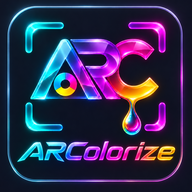
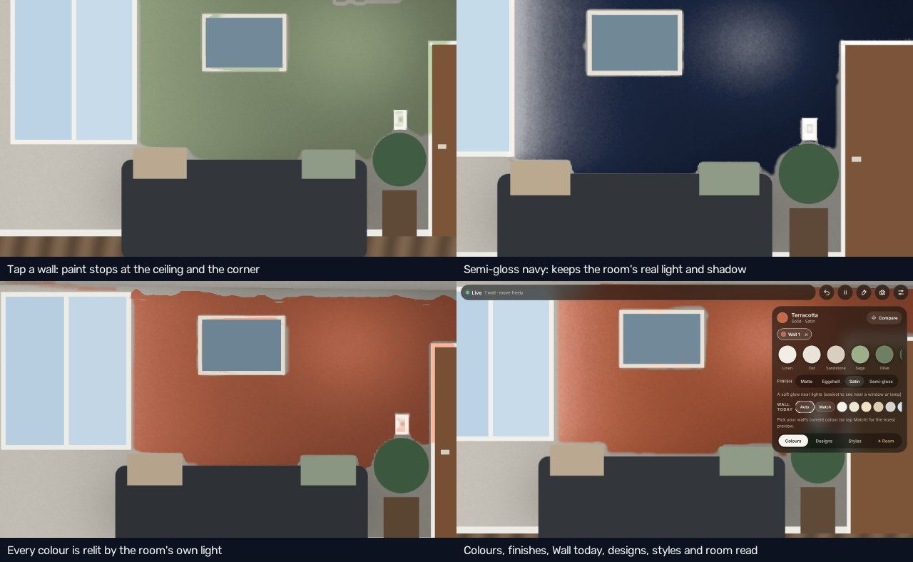

<p align="center"></p>

<h1 align="center">ARColorize: Real-Time AR Wall Repainting System</h1>

<p align="center">
  <b>Point your phone or laptop camera at a wall, tap it, and see it repainted live.</b><br>
  Shadows, lamp light and texture stay real, so the colour you see is the colour you get.
</p>

<p align="center">
  <a href="https://arcolorize.vercel.app"><b>▶ Live demo</b></a> ·
  <a href="#-whats-new-in-v20-november-2026">What's new</a> ·
  <a href="#-team">Team</a> ·
  <a href="#-results">Results</a> ·
  <a href="#-project-history">History</a>
</p>

---

## 🚀 What's new in v2.0 (November 2026)

**ARColorize Live** brings the project's AR wall-repainting vision to life. It's a real-time painter that runs in any modern browser on phones and laptops, with no app install and no backend.

<p align="center"></p>

| | Feature |
|---|---|
| 🎯 | **Tap-to-paint wall tracking.** One tap paints the whole wall and follows it as the camera moves. Paint stops cleanly at **room corners, the ceiling and the floor**, with ruler-straight edges. |
| 🧍 | **AI person occlusion.** On-device person segmentation (MediaPipe, GPU) keeps people unpainted while the wall behind them is painted. |
| 🪟 | **Smart surface detection.** Windows, lights and patterned surfaces are recognised and politely refused. |
| 💡 | **Physically based relighting.** Paint is relit by the room's measured light, including local light colour, corner inter-reflection and exposure handling. **Wall today** / **Match** sets the wall's current colour for the most accurate result. |
| ✨ | **Finishes:** matte, eggshell, satin and semi-gloss, with realistic sheen and window glare. |
| 🖌️ | **Designs and styles:** two-tone, stripes, ombré, mountain, arch, colour-block, curated palettes and an AI room read. |
| 🎞️ | **Steady picture.** Motion-aware temporal filtering keeps the view rock-steady when the camera is still. |
| ✍️ | **Touch-up brush**, before/after compare and one-tap photo save. |
| 📱 | Phone and laptop (Chrome, Edge, Safari); installable as an app with "Add to Home Screen". |

## ▶ Live demo

### 👉 **[arcolorize.vercel.app](https://arcolorize.vercel.app)**

Open it on a phone or laptop, tap **Start camera** (or **Try the demo room**), and tap a wall.

## 👥 Team

| Member | Role |
|---|---|
| **Ashwin Kumar A** | Team member |
| **Gurupraash R** | Team member |
| **Gokul S** | Team member |

_AR-Colorize Team: building a smarter way to choose wall colours since November 2025._

## 📊 Results

Measured with the reproducible bench in [`bench/`](bench/): a synthetic room with per-pixel ground truth, plus real webcam frames.

| Metric | Result |
|---|---|
| Paint on the ceiling, floor and neighbouring wall after tapping a wall | **0%** |
| Total paint outside the tapped wall | **~2–3%** |
| Taps on windows and lights correctly refused | **100%** |
| Colour accuracy vs. a true repaint (CIEDE2000) | **1.9** with *Wall today* (≈ the limit of what the eye can notice), 3.2 in auto mode |
| Pixels changing per frame on a still camera | **0.11%** (steady picture) |
| Speed on a laptop | **~30 fps**; tracking ~7–11 ms, person segmentation ~7–10 ms (GPU) |

Technical details: [`docs/TECHNICAL_REPORT.md`](docs/TECHNICAL_REPORT.md).

## ⚙️ How it works

```
camera ─► temporal de-noise ─► 224 px tracker ─┬─ colour/edge region growing from the tap
                                               ├─ corner & crease detection → straight corner lines
                                               ├─ person segmentation (MediaPipe)
                                               └─ window / texture checks
                      wall masks ─► GPU shader: joint-bilateral upsampling to full resolution,
                                    relighting (albedo × measured light), finish, compose
```

## 🗂️ Repository layout

```
web/      the app: index.html + service worker + manifest + icons (deployed on Vercel)
bench/    evaluation: synthetic room, spill/IoU harness, colour (ΔE00) and flicker benches
docs/     technical report and showcase images
code/     the project's first code folder (Nov 2025)
img/      project images
```

## 💻 Run locally

```bash
cd web
python -m http.server 8080        # open http://localhost:8080
```

## ☁️ Deploy

Vercel: **Add New Project** → import this repository → **Deploy**. `vercel.json` serves `web/` with no build step, and every push to `main` redeploys.

---

## 📜 Project history

| Date | Milestone |
|---|---|
| Nov 2025 | Project started: aim, problem statement, advantages and proposed features. |
| Dec 2025 | Team contributions to the project documentation. |
| Apr 2026 | Documentation refresh. |
| **Nov 2026** | **v2.0: ARColorize Live.** Real-time AR wall repainting in the browser. |

<details open>
<summary><b>Project proposal (November 2025)</b></summary>

### 🎨 AR Wall Repainting System 🖌️

#### ✨ Project Aim

Our project, the **AR Wall Repainting System**, aims to revolutionize the way users visualize and plan home or office wall repainting projects. By leveraging Augmented Reality (AR) technology, we empower users to virtually "paint" their walls with various colors and textures in real-time, directly through their smartphone or tablet camera. This eliminates uncertainty, reduces decision fatigue, and streamlines the entire repainting process from conceptualization to booking.

#### ⚠️ Problem Statement

Traditional wall repainting involves several challenges:
1.  **Uncertainty in Color/Texture Choice:** Users struggle to visualize how a particular paint color or texture will look on their actual walls under different lighting conditions, leading to dissatisfaction or costly repaints.
2.  **Trial and Error:** Reliance on physical paint swatches is cumbersome and often doesn't provide a realistic impression, necessitating multiple trips to stores and sample purchases.
3.  **Lack of Professional Guidance:** Many users lack design expertise and find it difficult to choose complementary colors or suitable textures for their spaces.
4.  **Inefficient Planning & Quotation:** Getting accurate quotes and planning for a repainting job can be time-consuming and involve multiple site visits before any work begins.

#### ✅ Advantages

Our AR Wall Repainting System offers significant advantages:
* **Real-time Visualization:** See paint colors and textures applied instantly to your walls through AR, enabling confident decision-making.
* **Reduced Risk & Cost:** Minimize the risk of choosing the wrong color, saving time, money, and avoiding project delays.
* **Enhanced User Experience:** Provide an interactive, engaging, and fun way to explore design possibilities.
* **Personalized Recommendations:** Integrate intelligent features to suggest color palettes and textures based on room type, lighting, and existing decor.
* **Streamlined Project Planning:** Generate instant estimates and easily connect with painting professionals or service providers through the app.
* **Accessibility:** Make professional-grade visualization tools accessible to everyone with a smartphone.

#### 🚀 Key Features (Proposed)

* **Live AR Painting:** Apply virtual paint and textures to real-world walls.
* **Color Palette Picker:** Extensive library of colors from popular brands.
* **Texture Options:** Visualize different finishes like matte, gloss, satin, or even wallpaper textures.
* **Instant Quotation:** Get estimated costs based on wall area and chosen materials.
* **Save & Share Designs:** Save favorite designs and share with friends, family, or professionals.
* **Recommendation Engine:** AI-powered suggestions for color schemes.
* **Service Booking Integration:** Connect with local painters or repainting services.

#### 👥 Team Members

This project is brought to you by:

* **Ashwin Kumar A**
* **Gurupraash R**
* **Gokul S**

---

#### 🛠️ Technologies Used

* **Frontend:** Unity (for AR), C#, React Native / Flutter (for mobile UI)
* **Backend:** Node.js / Python (Flask/Django)
* **Database:** MongoDB / PostgreSQL
* **AR SDK:** ARCore / ARKit
* **Cloud Platform:** AWS / Google Cloud

#### 📈 Future Enhancements

* Integration with smart home systems for dynamic lighting simulation.
* Advanced object detection to automatically mask furniture/decor.
* Collaborative design features for multiple users.
* Integration with IoT color sensors for precise color matching...

---

</details>

---

<p align="center"><sub>© AR-Colorize Team: Ashwin Kumar A · Gurupraash R · Gokul S. Licensed under GPL-3.0 (see LICENSE.txt).</sub></p>
