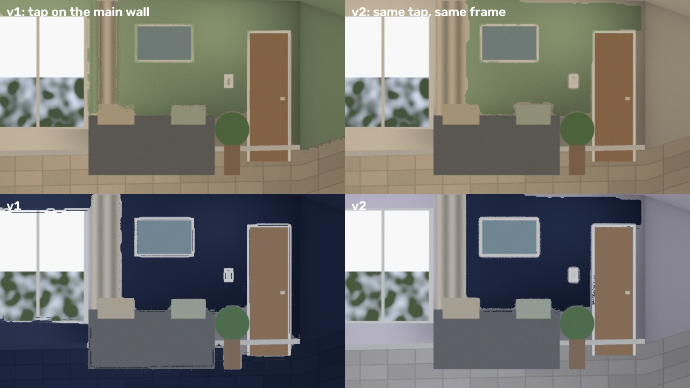

<p align="center"></p>

<h1 align="center">ARColorize: Real-Time AR Wall Repainting</h1>

<p align="center">
  <b>Point your phone or laptop camera at a wall, tap it, and see it repainted live.</b><br>
  Shadows, lamp light and texture stay real, so the colour you see is the colour you get.
</p>

<p align="center">
  <a href="#-live-demo"><b>▶ Live demo</b></a> ·
  <a href="#-whats-new-in-v20-november-2026">What's new</a> ·
  <a href="#-results">Results</a> ·
  <a href="#-project-history">History</a>
</p>

---

## 🚀 What's new in v2.0 (November 2026)

The project began in **November 2025** as a proposal (kept below under [Project history](#-project-history)). **v2.0** is the first working release: a real-time AR wall painter that runs in any modern browser. It needs no app install, no Unity and no backend.

<p align="center"></p>

| | Feature |
|---|---|
| 🎯 | **Tap-to-paint wall tracking** at 224 px. Paint stops at **room corners, the ceiling and the floor**: soft corners are detected (Hessian valleys and the structure tensor) and fitted to straight lines for crisp edges. |
| 🧍 | **AI person occlusion**: the MediaPipe Selfie Segmenter on the GPU keeps people unpainted, even in a shirt the same colour as the wall. |
| 🪟 | **Window, lamp and texture rejection** for taps that aren't on a wall. |
| 💡 | **Physically based relighting**: paint = albedo × the room's measured light, with local light colour, inter-reflection and exposure handling. **Wall today** / **Match** set the wall's current colour for exact light. |
| ✨ | **Finishes**: matte, eggshell, satin and semi-gloss, with glare and highlights in the light's colour. |
| 🖌️ | **Designs and styles**: two-tone, stripes, ombré, mountain, arch, colour-block, curated palettes and an AI room read. |
| 🎞️ | **Steady picture**: motion detection, temporal de-noising and coverage memory, giving 12× less flicker. |
| ✍️ | **Touch-up brush**, before/after compare and save photo. |
| 📱 | Phone and laptop (Chrome, Edge, Safari); installable as an app. |

These deliver the "Live AR Painting", "Texture Options" and "Advanced object detection to automatically mask furniture/decor" items from the original proposal.

## ▶ Live demo

**Live app:** _deploying on Vercel. The link will appear here._

Open it on a phone or laptop, tap **Start camera** (or **Try the demo room**), and tap a wall. The camera needs HTTPS, which the Vercel link provides.

## 📊 Results

Measured with the reproducible bench in [`bench/`](bench/) (synthetic room with ground truth, plus real webcam frames):

| Tap on the main wall | Ceiling | Side wall | Floor | Total spill |
|---|---|---|---|---|
| First prototype | 100% | 100% | up to 97% | 38–51% |
| **v2.0** | **0%** | **0%** | **0%** | **~2–3%** |

- **Colour fidelity** (CIEDE2000 against a true repaint): 3.2 in auto mode, **1.9 with *Wall today***.
- **Flicker** on a still camera: pixels switching per frame dropped from 1.3% to **0.11%**.
- **Speed** on a laptop: about 30 fps, with tracking at about 7–11 ms and person segmentation at about 7–10 ms (GPU).

Full log: [`docs/DEVELOPMENT_LOG.md`](docs/DEVELOPMENT_LOG.md).

## 🗂️ Repository layout

```
web/      the app: a single index.html + service worker + manifest + icons (deployed to Vercel)
bench/    evaluation: synthetic room, spill/IoU harness, colour (ΔE00) and flicker benches
docs/     development log and comparison images
code/     original 2025 placeholder (kept for history)
```

## 💻 Run locally

```bash
cd web
python -m http.server 8080        # open http://localhost:8080 (localhost may use the camera)
```

## ☁️ Deploy

Vercel → **Add New Project** → import this repository → **Deploy**. `vercel.json` already points Vercel at `web/` with no build step. Every push to `main` redeploys.

---

## 📜 Project history

| Date | Milestone |
|---|---|
| Nov 2025 | Repository created; project aim, problem statement and proposed features written (below). |
| Dec 2025 | README updates (team contributions). |
| Apr 2026 | README refresh. |
| **Nov 2026** | **v2.0: ARColorize Live.** First working real-time release (this update). |

<details open>
<summary><b>Original proposal (November 2025)</b></summary>

### 🎨 AR Wall Repainting System 🖌️

#### ✨ Project Aim

Our project, the **AR Wall Repainting System**, aims to revolutionize the way users visualize and plan home or office wall repainting projects. By leveraging Augmented Reality (AR) technology, we empower users to virtually "paint" their walls with various colors and textures in real-time, directly through their smartphone or tablet camera. This eliminates uncertainty, reduces decision fatigue, and streamlines the entire repainting process from conceptualization to booking.

#### ⚠️ Problem Statement

Traditional wall repainting involves several challenges:
1.  **Uncertainty in Color/Texture Choice:** Users struggle to visualize how a particular paint color or texture will look on their actual walls under different lighting conditions, leading to dissatisfaction or costly repaints.
2.  **Trial and Error:** Reliance on physical paint swatches is cumbersome and often doesn't provide a realistic impression, necessitating multiple trips to stores and sample purchases.
3.  **Lack of Professional Guidance:** Many users lack design expertise and find it difficult to choose complementary colors or suitable textures for their spaces.
4.  **Inefficient Planning & Quotation:** Getting accurate quotes and planning for a repainting job can be time-consuming and involve multiple site visits before any work begins.

#### ✅ Advantages

Our AR Wall Repainting System offers significant advantages:
* **Real-time Visualization:** See paint colors and textures applied instantly to your walls through AR, enabling confident decision-making.
* **Reduced Risk & Cost:** Minimize the risk of choosing the wrong color, saving time, money, and avoiding project delays.
* **Enhanced User Experience:** Provide an interactive, engaging, and fun way to explore design possibilities.
* **Personalized Recommendations:** Integrate intelligent features to suggest color palettes and textures based on room type, lighting, and existing decor.
* **Streamlined Project Planning:** Generate instant estimates and easily connect with painting professionals or service providers through the app.
* **Accessibility:** Make professional-grade visualization tools accessible to everyone with a smartphone.

#### 🚀 Key Features (Proposed)

* **Live AR Painting:** Apply virtual paint and textures to real-world walls.
* **Color Palette Picker:** Extensive library of colors from popular brands.
* **Texture Options:** Visualize different finishes like matte, gloss, satin, or even wallpaper textures.
* **Instant Quotation:** Get estimated costs based on wall area and chosen materials.
* **Save & Share Designs:** Save favorite designs and share with friends, family, or professionals.
* **Recommendation Engine:** AI-powered suggestions for color schemes.
* **Service Booking Integration:** Connect with local painters or repainting services.

#### 👥 Team Members

This project is brought to you by:

* **Ashwin Kumar A**
* **Gurupraash R**
* **Gokul S**

---

#### 🛠️ Technologies Used

* **Frontend:** Unity (for AR), C#, React Native / Flutter (for mobile UI)
* **Backend:** Node.js / Python (Flask/Django)
* **Database:** MongoDB / PostgreSQL
* **AR SDK:** ARCore / ARKit
* **Cloud Platform:** AWS / Google Cloud

#### 📈 Future Enhancements

* Integration with smart home systems for dynamic lighting simulation.
* Advanced object detection to automatically mask furniture/decor.
* Collaborative design features for multiple users.
* Integration with IoT color sensors for precise color matching...

---

</details>

---

<p align="center"><sub>© AR-Colorize Team: Ashwin Kumar A · Gurupraash R · Gokul S. Licensed under GPL-3.0 (see LICENSE.txt).</sub></p>
